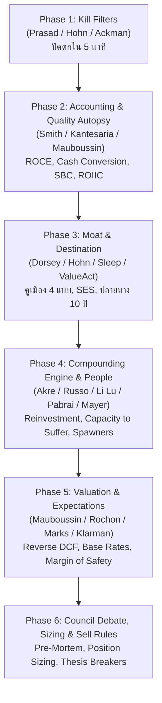

# คู่มือวิเคราะห์หุ้นฉบับสมบูรณ์แบบ "สภานักลงทุน" (Master Stock Analysis Playbook)

คู่มือนี้ถูกออกแบบให้เป็น **ระบบปฏิบัติการวิเคราะห์หุ้นเชิงปัจจัยพื้นฐานแบบครบวงจร (Institutional-Grade Fundamental Operating System)** โดยสังเคราะห์กรอบความคิดจากนักลงทุนทั้ง 17 ท่านในโฟลเดอร์ `profiles/` ให้ทำงานประสานกันตั้งแต่ **ด่านคัดทิ้งใน 5 นาทีแรก → การผ่าตัดงบการเงินและคูเมือง → การวัดรันเวย์ทบต้นและผู้บริหาร → การทำ Reverse DCF และคำนวณแต้มต่อ → การจำลองการโต้วาทีของสภานักลงทุน (Council Debate) → วินัยการให้น้ำหนักและกฎการขาย**

---

## โครงสร้างการทำงาน 6 เฟส (The 6-Phase Institutional Workflow)

---

## ข้อมูลเบื้องต้นของหุ้นที่กำลังวิเคราะห์ (Target Snapshot)

| หัวข้อ | ข้อมูล |
| :--- | :--- |
| **ชื่อบริษัท / Ticker / ตลาด** | |
| **ราคาปัจจุบัน / Market Cap / Enterprise Value (EV)** | |
| **อธิบายธุรกิจใน 2 ประโยค (Ackman / Li Lu Test)** | *ถ้าอธิบายให้เด็กมัธยมเข้าใจใน 2 ประโยคไม่ได้ แปลว่ายังไม่อยู่ใน Circle of Competence* |
| **แหล่งที่มาของไอเดีย (Idea Source)** | `[ ] Screening  [ ] 13F Cloning (Pabrai)  [ ] Spinoff/Forced Selling (Klarman)  [ ] Scuttlebutt` |
| **หมวดหมู่ธุรกิจ (Archetype)** | `[ ] Toll-Booth Monopoly  [ ] Scale Economies Shared  [ ] Serial Compounder  [ ] Spawner  [ ] Constructivist Turnaround  [ ] Special Situation` |

---

## Phase 1: ด่านคัดทิ้งใน 5 นาทีแรก (Darwinian Kill Filters)
**ผู้คุมด่าน:** *Pulak Prasad (Nalanda) • Chris Hohn (TCI) • Bill Ackman (Pershing Square)*

> **หลักการ:** ลด **Error of Commission** (ซื้อหุ้นพังโดยนึกว่าดี) ให้ใกล้ศูนย์ก่อนเสมอ หากติด "ตัวแดงเด็ดขาด" ให้ปิดแฟ้มทันทีโดยไม่เสียเวลาทำโมเดล

| # | เกณฑ์คัดทิ้ง (Kill Criteria) | ผ่าน / ไม่ผ่าน | หมายเหตุ / หลักฐาน |
| :--- | :--- | :---: | :--- |
| 1 | **โครงสร้างอุตสาหกรรม (Hohn):** ไม่ใช่ธนาคาร/ประกันที่งบทึบ, สายการบิน, ยานยนต์, ค้าปลีกทั่วไปที่ไร้คูเมือง, โภคภัณฑ์ (Price-Taker) หรือสื่อดั้งเดิมขาลง | `[ ] ผ่าน` `[ ] ตก` | |
| 2 | **งบดุลและการพึ่งพาตลาดทุน (Ackman / Prasad):** `Net Debt / EBITDA` ต่ำกว่า 2.5x (หรือมี Interest Coverage > 8x) และสามารถอยู่รอดได้ 2 ปีโดยไม่ต้องกู้เพิ่มหรือเพิ่มทุน | `[ ] ผ่าน` `[ ] ตก` | |
| 3 | **ไม่พึ่งพาปาฏิหาริย์ Turnaround หรือ Serial M&A ไร้ระบบ (Prasad):** ไม่ใช่บริษัทป่วยหนักที่ต้องลุ้นพลิกฟื้น หรือบริษัทที่โตด้วยการก่อหนี้ไล่ซื้อกิจการ | `[ ] ผ่าน` `[ ] ตก` | |
| 4 | **ธรรมาภิบาลสะอาด 100% (Prasad / Smith):** ไม่มีประวัติแต่งบัญชี, Related-Party Transactions ที่น่าสงสัย, หรือเอาเปรียบผู้ถือหุ้นรายย่อย | `[ ] ผ่าน` `[ ] ตก` | |
| 5 | **ความเสี่ยงภายนอกที่คุมไม่ได้ (Ackman):** ชะตากรรมธุรกิจไม่ได้ขึ้นกับราคาโภคภัณฑ์ อัตราแลกเปลี่ยน หรือคำสั่งรัฐที่เปลี่ยนข้ามคืน | `[ ] ผ่าน` `[ ] ตก` | |
| 6 | **ความเร็วการเปลี่ยนแปลงของเทคโนโลยี (Prasad / Kantesaria):** สามารถเห็นภาพโครงสร้างธุรกิจในอีก 7–10 ปีข้างหน้าได้อย่างสมเหตุสมผล (ไม่ถูก Disrupt ง่าย) | `[ ] ผ่าน` `[ ] ตก` | |

> **มติด่านที่ 1:** หากติดข้อ 4 (ธรรมาภิบาล) หรือติดตั้งแต่ 2 ข้อขึ้นไป → **PASS ทันที**

---

## Phase 2: ผ่าตัดงบการเงินและคุณภาพกำไร (Accounting & Quality Autopsy)
**ผู้คุมด่าน:** *Terry Smith (Fundsmith) • Dev Kantesaria (Valley Forge) • Michael Mauboussin*

### 2.1 ตารางตัวเลขคุณภาพย้อนหลัง 5–10 ปี (Full-Cycle Proof)

| ตัวชี้วัด (Metric) | สูตรคำนวณที่ถูกต้อง | เกณฑ์ระดับโลก (Target) | 10Y Avg | 5Y Avg | ล่าสุด | ทิศทาง |
| :--- | :--- | :--- | :---: | :---: | :---: | :---: |
| **Gross Margin** | `Gross Profit / Revenue` | > 50% (หรือมั่นคง/ขยายตัว) | | | | |
| **Operating Margin (GAAP)** | `EBIT / Revenue` | > 20% (ไม่ใช้ Adjusted!) | | | | |
| **ROCE** (*Terry Smith*) | `EBIT / (Total Assets - Current Liabilities)` หรือ `EBIT / (Equity + Debt - Cash)` | ≥ 20% ต่อเนื่องโดยไม่ปั่นหนี้ | | | | |
| **ROIC** (*Mauboussin*) | `NOPAT / Invested Capital` | > WACC อย่างน้อย +10% | | | | |
| **Cash Conversion** (*Smith*) | `Operating Cash Flow / Operating Profit` | ≥ 95% | | | | |
| **CapEx / Revenue** (*Kantesaria*) | `Capital Expenditures / Revenue` | ยิ่งต่ำยิ่งดี (< 5%–10% สำหรับ Asset-Light) | | | | |
| **SBC / Revenue & SBC / FCF** | `Stock-Based Comp / Revenue` | ยิ่งต่ำยิ่งดี (ระวังถ้า SBC > 20% ของ FCF) | | | | |
| **True Free Cash Flow (Owner's FCF)** | `OCF - Total CapEx - SBC` *(หรือแยก Maintenance CapEx)* | เติบโตสม่ำเสมอและเป็นบวกทุกปี | | | | |

### 2.2 การปรับแต่งงบการเงินแบบมืออาชีพ (Critical Accounting Adjustments)
1. **หัก Stock-Based Compensation (SBC) เป็นค่าใช้จ่ายเงินสดจริง (*Terry Smith / Chris Hohn*):**
   * ห้ามใช้ Adjusted EBITDA หรือ Non-GAAP FCF ที่บวกกลับ SBC เพราะ SBC คือต้นทุนจริงในการจ่ายพนักงานที่เจือจางผู้ถือหุ้น (หากบริษัทต้องเอาเงินสดไปซื้อหุ้นคืนเพื่อกลบ Dilution นั่นยิ่งพิสูจน์ว่า SBC คือเงินสดที่ไหลออกจริง)
2. **แยก Maintenance CapEx vs Growth CapEx (*Warren Buffett / Bruce Greenwald / Mauboussin*):**
   * เงินลงทุนส่วนไหนจ่ายเพื่อ **"รักษาฐานรายได้เดิมไม่ให้หด"** (Maintenance) และส่วนไหนจ่ายเพื่อ **"สร้างรายได้ใหม่ในอนาคต"** (Growth)?
   * หากเป็นธุรกิจยุคใหม่ที่ลงบัญชีการสร้างสินทรัพย์ระยะยาวไว้ใน R&D หรือ Sales & Marketing (เช่น SaaS / AI) ให้ใช้มุมมอง **Mauboussin (Intangibles Adjustment)** ตรวจดูว่า R&D/S&M นั้นสร้าง **Unit Economics (LTV/CAC, Payback Period)** ที่แท้จริงคุ้มค่าหรือไม่
3. **ตรวจสอบ "กลโกงบัญชี" (*Terry Smith — Accounting for Growth*):**
   * ลูกหนี้การค้า (Accounts Receivable) หรือสินค้าคงคลัง (Inventory) โตเร็วกว่ายอดขายหรือไม่?
   * มีการปรับโครงสร้าง (Restructuring Charges) ซ้ำซากทุกปีแล้วอ้างว่าเป็น "One-time" หรือไม่?
   * Goodwill บนงบดุลโตบวมจากการซื้อกิจการแพงๆ หรือไม่? (ถ้า ROCE รวม Goodwill ต่ำมาก แปลว่าผู้บริหารทำลายมูลค่าผ่าน M&A)

---

## Phase 3: ผ่าตัดคูเมืองและภาพปลายทาง 10 ปี (Moat Autopsy & Destination)
**ผู้คุมด่าน:** *Pat Dorsey • Chris Hohn • Nick Sleep • ValueAct Capital*

### 3.1 Moat Scorecard (*Pat Dorsey*)
> **คำเตือน:** "สินค้าดี", "ส่วนแบ่งตลาดสูง", "CEO เก่ง", และ "การดำเนินงานดีเยี่ยม" **ไม่ใช่คูเมือง!** (Mistaken Moats)

| แหล่งที่มาของคูเมือง | ความแข็งแกร่ง (0–5) | หลักฐานเชิงประจักษ์ & บททดสอบ |
| :--- | :---: | :--- |
| **1. Intangible Assets** (แบรนด์ที่มี Pricing Power / สิทธิบัตร / ใบอนุญาตผูกขาดจากรัฐ) | | *ทดสอบ:* ขึ้นราคา 5%–10% เหนือเงินเฟ้อได้โดย Volume ไม่ตกหรือไม่? |
| **2. Switching Costs** (ต้นทุน เวลา และความเสี่ยงในการย้ายค่าย) | | *ทดสอบ:* สินค้าฝังลึกใน Workflow แต่คิดเป็น % น้อยของต้นทุนลูกค้าใช่ไหม? (Mission-critical, low % of cost) |
| **3. Network Effects** (คุณค่าเพิ่มตามจำนวนผู้ใช้ / สองฝั่ง) | | *ทดสอบ:* เป็น Global หรือ Local? ลูกค้าใช้หลายเจ้าพร้อมกัน (Multi-homing) ง่ายไหม? |
| **4. Cost Advantages** (กระบวนการ / ทำเล / สินทรัพย์ผูกขาด / ขนาด) | | *ทดสอบ:* คู่แข่งที่มีเงิน $50B สร้างเลียนแบบใน 5 ปีได้ไหม? (*Chris Hohn Test*) |

* **ทิศทางคูเมือง (Moat Trend):** `[ ] กว้างขึ้นเรื่อยๆ (Widening)` `[ ] ทรงตัว (Stable)` `[ ] กำลังถูกกัดเซาะ (Eroding)`
* **Value Stick (*Michael Mauboussin*):** บริษัทเพิ่ม **Willingness to Pay (WTP)** ของลูกค้าได้ต่อเนื่อง หรือกด **Willingness to Sell (WTS)** ของซัพพลายเออร์ได้หรือไม่?

### 3.2 Scale Economies Shared & Destination Analysis (*Nick Sleep*)
1. **กลไกการเติบโต:** เมื่อบริษัทใหญ่ขึ้นเป็น 2–5 เท่า บริษัท **แบ่งปันความประหยัดกลับให้ลูกค้า** (ลดราคา/เพิ่มคุณค่า → ดึงลูกค้าเพิ่ม → ต้นทุนยิ่งต่ำ) หรือแค่ **รีดกำไรระยะสั้น (Rent Extraction)**?
2. **Destination Analysis (ภาพปลายทางอีก 10–20 ปี):**
   * เมื่ออุตสาหกรรมนี้โตเต็มที่ โครงสร้างตลาดจะเหลือผู้ชนะกี่ราย? บริษัทนี้จะมีส่วนแบ่งและมาร์จินที่เท่าไร?
   * **เสียงรบกวน vs ความเสี่ยงปลายทาง:** ข่าวลบที่ตลาดกังวลตอนนี้ เป็นแค่ "Noise ระหว่างทาง" หรือเป็น "รอยร้าวที่ทำให้ไปไม่ถึงปลายทาง"?
3. **Constructivist Opportunity (*ValueAct / Ackman / Hohn*):** หากธุรกิจมีคูเมืองสุดยอดแต่ราคาถูกเพราะผู้บริหารหย่อนยาน (เช่น ต้นทุนบวม, SBC สูงเกินไป, หรือยังไม่ปรับโมเดลเป็น SaaS/Cloud) มีตัวเร่ง (Catalyst) ที่จะปรับปรุงการดำเนินงานได้จริงหรือไม่?

---

## Phase 4: เครื่องจักรทบต้น, รันเวย์ลงทุนซ้ำ และคนคุมหางเสือ (Compounding Engine & People)
**ผู้คุมด่าน:** *Chuck Akre • Thomas Russo • Li Lu • Mohnish Pabrai • Chris Mayer*

### 4.1 สมการการทบต้น (The Compounding Formula — *Akre / Mauboussin*)
$$\text{Intrinsic Value Growth Rate} \approx \text{Reinvestment Rate} \times \text{ROIIC (Return on Incremental Invested Capital)}$$

* **คำนวณ ROIIC ย้อนหลัง 3–5 ปี:**
  $$\text{ROIIC} = \frac{\Delta \text{NOPAT}}{\Delta \text{Invested Capital}}$$
* **คำถามชี้ขาด (*Chuck Akre — ขาที่ 3 ของเก้าอี้*):**
  * บริษัทสามารถเอาเงินกำไรกลับไปลงทุนซ้ำได้กี่ % ของกระแสเงินสด (Reinvestment Rate)?
  * รันเวย์การเติบโต (TAM Penetration + Geographic Expansion + Pricing Power + New Products) ยังเหลือพื้นที่ให้ทบต้นได้อีกกี่ปี? (เป้าของ *Chris Mayer* คือรันเวย์อย่างน้อย 10 ปีเพื่อเปิดโอกาส Multi-Bagger)

### 4.2 คุณภาพผู้บริหารและโครงสร้างแรงจูงใจ (*Thomas Russo / Chris Mayer / Li Lu*)
* **Owner-Operator / Skin in the Game:** ผู้ก่อตั้งหรือครอบครัวถือหุ้นใหญ่เองไหม? แรงจูงใจผู้บริหารผูกกับ **ROIC & Per-Share Intrinsic Value** หรือผูกกับยอดขาย/Adjusted EPS ระยะสั้น?
* **Capacity to Suffer (*Thomas Russo*):** มีหลักฐานไหมว่าบริษัทกล้ายอมให้กำไรระยะสั้นดูแย่เพื่อลงทุนสร้างธุรกิจระยะยาว (แบบ Nestlé สร้าง Nespresso หรือ Amazon สร้าง AWS)?
* **Capital Allocation Scorecard (*Mauboussin / Terry Smith*):** ตรวจดูย้อนหลัง 5 ปีว่าเงินสดทุกดอลลาร์ถูกจัดสรรไปที่ไหนบ้าง:
  1. Organic Reinvestment (ดีที่สุดถ้า ROIIC สูง)
  2. M&A (สร้างมูลค่าจริงหรือจ่ายแพง?)
  3. Share Buybacks (ซื้อคืนตอนหุ้นถูกกว่ามูลค่าจริง หรือซื้อตอนแพงเพื่อกลบ SBC?)
  4. Dividends / Debt Reduction
* **Spawner DNA (*Mohnish Pabrai*):** บริษัทนี้เป็น Spawner ประเภทใด? (Adjacent / Embryonic / Cloner / Non-Adjacent / Apex) หรือฝากอนาคตทั้งหมดไว้กับสินค้าชิ้นเดียว?
* **Scuttlebutt Check (*Li Lu*):** ลองจำลองคำตอบจาก 3 กลุ่ม:
  * *ลูกค้า:* รักหรือเกลียด? ถ้าขึ้นราคาจะหนีไหม?
  * *คู่แข่ง:* กลัวจุดไหนของบริษัทนี้ที่สุด? ทำไมถึงสู้ไม่ได้?
  * *พนักงาน/อดีตพนักงาน:* วัฒนธรรมองค์กรเป็นแบบ Principal (คิดเพื่อลูกค้าระยะยาว) หรือ Bureaucracy?

---

## Phase 5: การประเมินมูลค่า, ความคาดหวัง และฝ่ายค้าน (Valuation, Expectations & Risk)
**ผู้คุมด่าน:** *Michael Mauboussin • François Rochon • Howard Marks • Seth Klarman • Mohnish Pabrai*

### 5.1 Step 1 — Reverse DCF / Expectations Investing (*Michael Mauboussin*)
> แทนที่จะเดาอนาคตแล้วสร้าง DCF (ซึ่งมักหลอกตัวเองง่าย) ให้ **"เริ่มจากราคาหุ้นวันนี้"** แล้วถอดสมการย้อนกลับว่าตลาดกำลังคาดหวังอะไรอยู่:

* ที่ราคาหุ้นปัจจุบัน ตลาดกำลัง Price-in ว่า:
  * รายได้ต้องโตเฉลี่ยปีละ ____% ต่อเนื่อง ____ ปี (Competitive Advantage Period: CAP)
  * Operating Margin ปลายทางต้องอยู่ที่ ____%
  * Terminal Multiple / Discount Rate ที่ ____%
* **Base Rate Check (*Mauboussin — The Outside View*):** จากข้อมูลสถิติประวัติศาสตร์ ในบรรดาบริษัทขนาดเท่านี้ในโลก มีกี่ % ที่สามารถทำอัตราการเติบโตและมาร์จินระดับนี้ได้จริงต่อเนื่อง 5–10 ปี? เรากำลังเชื่อแบบ "Inside View (โลกสวย)" เกินไปหรือเปล่า?

### 5.2 Step 2 — การวัดผลตอบแทนคาดหวัง 3 ฉากทัศน์ (5-Year Forward IRR — *Rochon / Kantesaria / Pabrai*)
* **เกณฑ์เทียบ (Benchmarks):**
  * *François Rochon:* มองหาหุ้นที่ **กำไรต่อหุ้น (Owner's Earnings) และราคาหุ้นมีโอกาสโต 2 เท่าใน 5 ปี (~15% CAGR)** โดยซื้อที่ราว 10–15x ของกำไรคาดการณ์อีก 5 ปีข้างหน้า
  * *Dev Kantesaria / Terry Smith:* เทียบ **True FCF Yield (หลังหัก SBC) + คาดการณ์การเติบโตของ FCF** กับผลตอบแทนพันธบัตรรัฐบาลสหรัฐฯ 10 ปี (10Y Treasury) เพื่อดู Equity Risk Premium

| ฉากทัศน์ (5-Year Horizon) | การเติบโตของ FCF/Share (CAGR) | Exit Multiple (P/FCF) | ราคาเป้าหมายปีที่ 5 | IRR ต่อปี (%) | โอกาสเกิด (%) |
| :--- | :---: | :---: | :---: | :---: | :---: |
| **Bear Case (กรณีแย่ — Downside Floor)** | | | | | |
| **Base Case (กรณีปกติ)** | | | | | |
| **Bull Case (กรณีดีเยี่ยม — Spawner/SES ติดลม)** | | | | | |

### 5.3 Step 3 — ด่านฝ่ายค้านคุมความเสี่ยง (*Howard Marks & Seth Klarman*)
1. **Second-Level Thinking (*Marks*):**
   * *First-Level (ตลาดคิดอะไร):* ______________________________________
   * *Second-Level (เราคิดต่างจากตลาดตรงไหน และทำไมเราถึงน่าจะถูก):* ______________________________________
2. **Market Temperature & Cycle Check (*Marks*):** บรรยากาศรอบหุ้นตัวนี้ตอนนี้อยู่จุดไหนของลูกตุ้ม? (`[ ] กลัวสุดขีด/ถูกทอดทิ้ง  [ ] เฉยๆ  [ ] คลั่งไคล้/Priced for Perfection`)
3. **Dhandho Asymmetry & Margin of Safety (*Pabrai / Klarman*):**
   * ถ้า Bear Case เกิดขึ้นจริง เราจะขาดทุนถาวรสูงสุดกี่ %?
   * มีความไม่สมมาตรแบบ **"ออกหัวชนะใหญ่ ออกก้อยเจ็บน้อย"** จริงหรือไม่?
   * อะไรคือ **Forced Selling / Temporary Uncertainty** ที่ทำให้เรามีโอกาสซื้อได้ถูกกว่ามูลค่าจริง?
4. **Pre-Mortem (ชันสูตรล่วงหน้า — ห้ามข้าม!):**
   * *สมมติวันนี้คืออีก 5 ปีข้างหน้า และหุ้นตัวนี้ขาดทุนหนัก 50% — จงเขียนเหตุผล 3 ข้อที่เป็นไปได้มากที่สุดว่ามันพังเพราะอะไร:*
     1. __________________________________________________
     2. __________________________________________________
     3. __________________________________________________

---

## Phase 6: การเปิดสภาโต้วาทีสด, การให้น้ำหนัก และกฎการขาย (Live Council Debate, Sizing & Sell Discipline)

### 6.0 โหมดสภาโต้วาทีแยกสมองจริง (True Split-Brain Multi-Agent Debate — ไม่ใส่อรรถรส)
> **กติกาหลักที่บันทึกไว้เป็นค่าเริ่มต้น:**
> 1. **ไม่ใส่อรรถรส / ไม่แสดงละคร:** ตัดบทสนทนาสมมติเชิงดราม่าออกทั้งหมด เน้นข้อโต้แย้งเชิงสถาบันที่ตรงประเด็นและตรวจสอบได้
> 2. **แยกสมองจริงด้วย 2 Subagents อิสระ (Bull Analyst vs. Bear Risk Analyst):** ต่างฝ่ายต่างไปค้นข้อมูลและอ่านโปรไฟล์เฉพาะฝั่งตัวเอง แล้วส่งประเด็นจี้จุดตายให้ **ซักค้านโต้กลับกันจริง (Round 2 Cross-Examination)** ก่อนให้ประธานสภา (Michael Mauboussin) ชี้ขาด
> 3. **สมดุล 50% เชิงปริมาณ (งบการเงิน/บัญชี/DCF) + 50% เชิงคุณภาพ (Qualitative & Scuttlebutt):** ห้ามถกกันแค่ตัวเลขบัญชีอย่างเดียว — ทั้งฝั่ง Bull และ Bear **ต้องวิเคราะห์และซักค้านครบทั้ง 5 มิติเชิงคุณภาพ** เสมอ:
>    * **Grassroots & Unofficial Scuttlebutt (*Li Lu* — ห้ามรอแต่ข่าว Official ที่มักช้าไป!):** ต้องขุดข้อมูล **นอกกระแส/หน้างานจริง (Leading Indicators)** เสมอ ได้แก่ **Reddit (`site:reddit.com`), เว็บบอร์ดเฉพาะทาง/สายอาชีพ (Industry Forums, Hacker News, Pantip/ThaiVI), เสียงพนักงาน (Glassdoor, Blind), รีวิวลูกค้า/คู่ค้า (Trustpilot, App Store) และเรื่องเล่าภาคสนาม (Practitioner Podcasts/Threads)** — พร้อมคัดกรองแยก "เสียงบ่นรายบุคคล (Noise)" ออกจาก "แพตเทิร์นซ้ำๆ เชิงโครงสร้าง (Structural Signal)" และระบุแหล่งที่มาให้ชัดว่าอันไหน `[Official]` vs `[Reddit/Board/Scuttlebutt]`
>    * **Leadership, Culture & Incentives (*Nick Sleep / Thomas Russo / Chuck Akre*):** วัฒนธรรมองค์กรแบบ Principal vs. ระบบราชการ (Bureaucracy), สงครามแย่งคนเก่ง (Talent Retention), ประวัติการรักษาคำพูดของ CEO และ Capacity to Suffer
>    * **Product & Ecosystem Reality (*Pat Dorsey / Chris Hohn*):** คุณภาพสินค้าจริงเมื่อเทียบคู่แข่งแบบจุดต่อจุด, พฤติกรรมผู้ใช้ที่เปลี่ยนไป, และความเหนียวแน่นของ Ecosystem
>    * **Spawner DNA & 10-Year Destination (*Mohnish Pabrai / Nick Sleep*):** โครงสร้างอุตสาหกรรมในอีก 10–20 ปีข้างหน้า และความสามารถในการสร้างธุรกิจใหม่ให้ชนะจริง
>    * **Regulatory, Geopolitical & Narrative Risk (*Howard Marks*):** แรงต้านจากรัฐ/สังคม/สื่อ และความเสี่ยงที่เรื่องเล่า (Narrative) ของตลาดกำลังสุดโต่งไปฝั่งใดฝั่งหนึ่ง

#### โครงสร้างการรันแยกสมองจริง
1. **Round 1 — Independent Briefs:** Bull Subagent และ Bear Subagent ทำงานแยกกันอิสระ (ทั้งเชิงปริมาณ + เชิงคุณภาพ 5 มิติ โดยต้องมี **หลักฐานจริงจาก Reddit/บอร์ด/เสียงหน้างานนอก Official** ประกอบทั้งสองฝั่ง) พร้อมตั้ง 3 คำถามท้าทายตรงเป้าให้อีกฝั่ง
2. **Round 2 — Real Cross-Examination:** ส่ง 3 คำถามและจุดอ่อนที่อีกฝั่งขุดเจอไปให้แต่ละ Subagent โต้กลับด้วยหลักฐานจริง (ห้ามเลี่ยงคำถาม) พร้อมระบุ **Flip Conditions** (เงื่อนไขที่จะยอมเปลี่ยนใจ)
3. **Round 3 — Chairman Synthesis (Michael Mauboussin):** ตัดสินว่าฝั่งไหนชนะในแต่ละสมรภูมิ (ทั้งด้านบัญชี, ด้านคุณภาพ และเทียบสัญญาณหน้างาน Reddit/Board กับงบ Official), รัน Explicit/Reverse DCF กลาง, สรุป **1–2 Crucible Variables** และลงมติ Position Sizing + Thesis Breakers

---

### 6.1 ตารางลงมติสภานักลงทุน (Council Scorecard)

| สมาชิกสภา | สิ่งที่เขาจะชม / เห็นด้วย | สิ่งที่เขาจะติง / ระแวง | มติ |
| :--- | :--- | :--- | :---: |
| **Chris Hohn (TCI)** | *(Moat, Hard Assets, Pricing Power)* | | `[ ] ซื้อ  [ ] รอ  [ ] ผ่าน` |
| **Bill Ackman (Pershing)** | *(กฎ 8 ข้อ, ความเรียบง่าย, Catalyst)* | | `[ ] ซื้อ  [ ] รอ  [ ] ผ่าน` |
| **Dev Kantesaria / Terry Smith** | *(ROCE, Cash Conversion, Toll-Booth)* | | `[ ] ซื้อ  [ ] รอ  [ ] ผ่าน` |
| **Nick Sleep (Nomad)** | *(Scale Economies Shared, ปลายทาง 10 ปี)* | | `[ ] ซื้อ  [ ] รอ  [ ] ผ่าน` |
| **Chuck Akre / Thomas Russo** | *(Reinvestment Runway, Capacity to Suffer)* | | `[ ] ซื้อ  [ ] รอ  [ ] ผ่าน` |
| **Li Lu / Mohnish Pabrai** | *(Scuttlebutt, Dhandho, Spawner)* | | `[ ] ซื้อ  [ ] รอ  [ ] ผ่าน` |
| **Pulak Prasad / Pat Dorsey** | *(Darwin Filter, Moat 4 แบบ)* | | `[ ] ซื้อ  [ ] รอ  [ ] ผ่าน` |
| **Howard Marks / Seth Klarman** | *(Second-Level Thinking, Downside, Cycle)* | | `[ ] ซื้อ  [ ] รอ  [ ] ผ่าน` |

### 6.2 กฎการให้น้ำหนักพอร์ต (Position Sizing Rules)
* **Starter / Tracking Position (2%–4%):** ธุรกิจน่าสนใจมากแต่ยังต้องติดตาม Scuttlebutt เพิ่ม หรือราคายังไม่ให้ Margin of Safety สูงพอ
* **Core Position (5%–10%):** ผ่านเกือบทุกด่านในสภา มีความเชื่อมั่นสูง Downside จำกัด และคาดหวัง IRR ≥ 12%–15%
* **High-Conviction Concentrated Bet (10%–20% — *Hohn / Ackman / Kantesaria / Sleep Style*):** ใช้เฉพาะกับธุรกิจระดับกึ่งผูกขาดที่เข้าใจทะลุปรุโปร่ง งบดุลแข็งแกร่งมาก และราคาตกเพราะความไม่แน่นอนชั่วคราวจนให้ Margin of Safety มหาศาล *(คำเตือน: ถ้ารู้สึกไม่กล้าถือผ่านช่วงหุ้นตก -30% แปลว่าขนาดพอร์ตใหญ่เกินระดับความเข้าใจของเรา)*

### 6.3 กฎเหล็กในการขาย (Sell Discipline — *Akre / Smith / Prasad / Rochon*)
> **ห้ามขายเพียงเพราะ:** หุ้นขึ้นมามากแล้ว, กังวลข่าวเศรษฐกิจมหภาคระยะสั้น, หรือ P/E ขยายตัวขึ้นเล็กน้อย (*"The Art of Not Selling" — Chuck Akre*)

**จะยอมขายต่อเมื่อเข้าเงื่อนไขอย่างใดอย่างหนึ่งต่อไปนี้เท่านั้น (Thesis Breakers):**
1. **Thesis Broken / Moat Eroding:** คูเมืองเริ่มถูกกัดเซาะเชิงโครงสร้างจริง (เช่น ลูกค้าเริ่มย้ายค่าย, Pricing Power หาย, เทคโนโลยีใหม่มาแทนที่) หรือพบว่าสมมติฐานตอนซื้อผิดตั้งแต่แรก
2. **Governance / Capital Allocation Breakdown:** ผู้บริหารเริ่มทำลายมูลค่า (เช่น ก่อหนี้ซื้อกิจการแพงๆ, โกหกผู้ถือหุ้น, แจก SBC มหาศาลโดยไร้เหตุผล)
3. **Extreme Valuation Absurdity:** ราคาหุ้นพุ่งขึ้นไปแพงแบบไร้เหตุผลจน Reverse DCF บอกว่าต้องโตระดับที่เป็นไปไม่ได้ในทางสถิติ (Expected Future IRR ต่ำกว่าพันธบัตรรัฐบาลมาก)
4. **Superior Opportunity Cost:** พบหุ้นอีกตัวที่มีคุณภาพเท่ากันหรือดีกว่า แต่ให้ผลตอบแทนคาดหวังและแต้มต่อสูงกว่าอย่างมีนัยสำคัญ

* **ระบุ Thesis Breakers เฉพาะตัวของหุ้นนี้ (ต้องเขียนไว้ก่อนกดซื้อเสมอ!):**
  1. __________________________________________________
  2. __________________________________________________

---

## คำสั่งสำเร็จรูปสำหรับเรียกใช้ AI ช่วยวิเคราะห์ (Prompt Templates)

เวลาต้องการคุยวิเคราะห์หุ้นจริง คุณสามารถพิมพ์สั่งแบบนี้ได้เลย:
* **แบบเต็มสภา + ถกกันสด 3 ยก:** *"เอาหุ้น [ชื่อหุ้น] เข้ากระบวนการ 6 เฟส แล้วให้สภาถกกันสด 3 ยก"*
* **แบบแยกสมองจริง (Multi-Agent Real Debate):** *"เปิดศึกแยก Subagent ถกกันจริงเรื่อง [ชื่อหุ้น] ระหว่างฝ่ายเชียร์กับฝ่ายค้าน"*
* **แบบดวลเปรียบเทียบหุ้น:** *"ให้สภาถกกันหน่อยว่าควรขาย [หุ้น A] ไปซื้อ [หุ้น B] ดีไหม"*
* **แบบเจาะงบและราคา:** *"ลองทำ Reverse DCF แบบ Michael Mauboussin และตรวจ ROCE / Cash Conversion / SBC แบบ Terry Smith ให้หุ้น [ชื่อหุ้น] หน่อย"*
